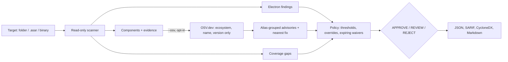

# Software Intake Gatekeeper

[](https://github.com/Sushant-Nemade/software-intake-gatekeeper/actions/workflows/ci.yml)
[](https://github.com/marketplace/actions/software-intake-gatekeeper)
[](https://pypi.org/project/software-intake-gatekeeper/)
[](https://github.com/Sushant-Nemade/software-intake-gatekeeper/blob/main/LICENSE)

**Before you install, approve or ship a third-party app, find out what is inside it.**

Software Intake Gatekeeper reads an installed application, an Electron `.asar` archive or a
compiled binary. It never runs or unpacks it. It produces:

- a **CycloneDX 1.6 SBOM** of the components that are actually bundled,
- **known vulnerabilities** for those exact versions from [OSV.dev](https://osv.dev) (only when you opt in),
- **Electron hardening checks** for the fuse wire inside the executable and risky `BrowserWindow`
  settings in the app code,
- an **APPROVE / REVIEW / REJECT** decision from a versioned policy, with expiring waivers,
- an **update check** that compares two versions and gates on what the update *adds*: new
  vulnerabilities, weakened Electron fuses, new network endpoints, new native modules,
- **SARIF** for GitHub code scanning, a **Markdown** summary for pull requests and a full **JSON** evidence report.

Every finding names the file and, for scripts, the line, column and snippet that produced it.
Anything the scanner could not verify is reported as a **coverage gap**. A blocking gap can
never lead to APPROVE: an unknown result is not treated as safe.

> Status: [v0.2.1](https://github.com/Sushant-Nemade/software-intake-gatekeeper/releases/tag/v0.2.1),
> an alpha release on [PyPI](https://pypi.org/project/software-intake-gatekeeper/) and the
> [GitHub Marketplace](https://github.com/marketplace/actions/software-intake-gatekeeper). The CLI is
> tested on Windows and Linux with real Go binaries in three object formats, an ASAR archive packed
> by the official `@electron/asar` tool and the live OSV API; the action also runs on macOS. The
> results are static, version-level evidence, not proof of exploitability.

Part of a small **software trust toolkit** with
[Privacy Flow Inspector](https://github.com/Sushant-Nemade/privacy-flow-inspector): this tool checks
what is **inside** an app; the inspector checks which personal data the app **sends out**.


## Where it helps

| Who | Situation | What they get |
|---|---|---|
| IT / security intake | An employee requests a desktop tool (an Electron or Go CLI) | An SBOM, known CVEs and Electron hardening issues before approval, with a decision a reviewer can sign off |
| Product teams shipping Electron | A release candidate is ready | A CI gate that fails when `contextIsolation` is off, `RunAsNode` is enabled or bundled packages have critical advisories |
| Supply-chain / compliance (EU CRA, medical-device SBOM expectations) | A vendor delivers a binary without an SBOM | A CycloneDX SBOM built from evidence inside the binary, with occurrences pointing to the source files |
| Procurement / vendor review | Comparing two vendor builds | Reproducible JSON and SBOM output that can be compared across versions |

## Quick start

Install from [PyPI](https://pypi.org/project/software-intake-gatekeeper/) (Python 3.11+):

```powershell
python -m pip install software-intake-gatekeeper
```

To verify build provenance first, install the wheel from the GitHub release instead:

```powershell
gh release download v0.2.1 -R Sushant-Nemade/software-intake-gatekeeper -p "*.whl"
gh attestation verify software_intake_gatekeeper-0.2.1-py3-none-any.whl -R Sushant-Nemade/software-intake-gatekeeper
python -m pip install software_intake_gatekeeper-0.2.1-py3-none-any.whl
```

Or install from a clone (needed for the demo below):

```powershell
git clone https://github.com/Sushant-Nemade/software-intake-gatekeeper
cd software-intake-gatekeeper
python -m pip install .
```

Then scan:

```powershell
# Offline inventory and Electron checks (no network):
intake-gatekeeper scan "C:\Program Files\SomeApp"

# Add known-vulnerability lookup and write every report:
intake-gatekeeper scan "C:\Program Files\SomeApp" --osv `
  --json reports/report.json --sarif reports/report.sarif `
  --cyclonedx reports/sbom.cdx.json --markdown reports/summary.md
```

Exit status: `0` the decision passed the `--fail-on` threshold (default `reject`), `1` the gate
failed, `2` usage or input error. Run `intake-gatekeeper rules` to list the configuration rules.

### Try the fictional vulnerable demo

`examples/vulnerable-demo` is a deliberately insecure, **fictional** target. It contains an ASAR
archive packed by the official `@electron/asar` tool, a `.deps.json` file and, after the build
step, a real Go binary and a synthetic Electron executable stand-in.

```powershell
python scripts/build_demo.py      # Go is optional; it builds the real Go demo binary
intake-gatekeeper scan examples/vulnerable-demo --osv --policy examples/intake-policy.toml
```

Real output (2026-10-14, live OSV):

```text
Decision: REJECT
  - 19 finding(s) at or above high.
  - 41 finding(s) between low and high.
Target: vulnerable-demo | files 5 | archive entries 8 | lookup osv
Components: Go 3, NuGet 2, npm 5
Findings: critical 1, high 18, medium 31, low 10, info 0
Electron 28.0.0 at bin/electron-runtime-stand-in.bin
  [CRITICAL] GHSA-xvch-5gv4-984h minimist 1.2.5: Prototype Pollution in minimist @ resources/app.asar!/node_modules/minimist/package.json
  [HIGH    ] EGK-FUSE-RUN-AS-NODE RunAsNode fuse is enabled @ bin/electron-runtime-stand-in.bin
  [HIGH    ] EGK-JS-CONTEXT-ISOLATION-OFF Context isolation is disabled @ resources/app.asar!/main.js:12
  [HIGH    ] EGK-JS-NODE-INTEGRATION Renderer has Node.js integration enabled @ resources/app.asar!/main.js:11
  [HIGH    ] GHSA-5crp-9r3c-p9vr Newtonsoft.Json 12.0.1: Improper Handling of Exceptional Conditions in Newtonsoft.Json @ dotnet/IntakeDemo.deps.json
  [HIGH    ] GHSA-69ch-w2m2-3vjp golang.org/x/text v0.3.7: golang.org/x/text/language Denial of service via crafted Accept-Languag... @ bin/intake-demo-tool.exe
  ...
```

The Markdown summary also includes a table of components with known vulnerabilities and the
smallest listed fixed version above the current one (for example `minimist 1.2.6`,
`Newtonsoft.Json 13.0.1`). One lodash advisory shows as *waived* because the example policy
accepts it until 2026-12-31 with a written reason.

### Check an update before rolling it out

`diff` scans the version you run today and the new one, then decides on **what the update adds**.
Persisting issues are listed but do not block the update; run `scan` for an absolute assessment.

```powershell
intake-gatekeeper diff examples/update-demo/v1 examples/update-demo/v2 --osv `
  --json reports/update.json --markdown reports/update.md --sarif reports/update.sarif
```

Real output for the fictional [update demo](https://github.com/Sushant-Nemade/software-intake-gatekeeper/tree/main/examples/update-demo) (2026-10-14, live OSV). Version 2
fixes a `nodeIntegration` setting and upgrades lodash, but adds axios 0.21.1, a telemetry endpoint and
a native module:

```text
Update decision: REJECT
  - 12 new finding(s) at or above high.
  - 13 new finding(s) between low and high.
  - 1 new network endpoint(s) referenced by app code.
  - 1 new executable(s) or native module(s).
  - 1 new component(s).
Findings: 25 new, 4 resolved, 1 persisting
Components changed: 2 | endpoints +1/-0 | binaries +1/-0/~0
  NEW [HIGH    ] GHSA-cph5-m8f7-6c5x axios 0.21.1: axios Inefficient Regular Expression Complexity vulnerability
  ...
  NEW endpoint collect.metrics-collector.example
```

| The update check reports | How it is matched |
|---|---|
| New and resolved findings | Advisory id plus package name (so a version bump that keeps the bug counts as persisting), or rule plus file |
| Component changes | Added, removed or changed versions per ecosystem and name |
| Electron | Runtime version change and every fuse change; a fuse moving into its risky state is **weakened** |
| Network endpoints | Hosts in `http(s)://` and `ws(s)://` URLs in app code (outside `node_modules`), without XML namespaces or local addresses |
| Executables and native modules | Added, removed or changed (SHA-256) PE, ELF and Mach-O files, including `.node` modules |

**REJECT** if a new finding reaches `reject_at`. **REVIEW** for new findings at `review_at`, weakened
fuses, new endpoints, new binaries, new components or blocking gaps in the new version.
**APPROVE** otherwise. The SARIF output contains only the new findings.

## What it inspects

| Evidence | Source inside the target | Output |
|---|---|---|
| Go modules and toolchain | Build info embedded by the Go linker (Go 1.18+) in PE, ELF and Mach-O executables | `pkg:golang/...` components, including `stdlib` and `replace` directives |
| npm packages | `node_modules/**/package.json` on disk and inside `.asar` archives | `pkg:npm/...` components; the app's own manifest is recorded but not queried |
| NuGet packages | `*.deps.json` (`package` and self-contained `runtimepack` entries) | `pkg:nuget/...` components |
| .NET shared framework | `*.runtimeconfig.json` | Minimum framework version, plus a note that the host runtime decides the patch level |
| Electron runtime | The fuse sentinel and `Electron/x.y.z` string in the executable | Electron version (queried as npm `electron`) and the fuse states |
| Electron app code | `.js/.cjs/.mjs/.ts` files outside `node_modules`, on disk or in `.asar` | `webPreferences` rule findings with line, column and snippet |
| Network endpoints | `http(s)://` and `ws(s)://` hosts referenced by that app code | Host list with up to three source files each (used by the update check) |
| Executables and native modules | PE, ELF and Mach-O files, including `.node` add-ons | Path, size, SHA-256 and kind (Go, Electron, native) |

### Electron rules

| Rule | Default | Detects |
|---|---|---|
| `EGK-JS-NODE-INTEGRATION` | high | `nodeIntegration: true` (also minified `!0`) |
| `EGK-JS-CONTEXT-ISOLATION-OFF` | high | `contextIsolation: false` |
| `EGK-JS-WEB-SECURITY-OFF` | high | `webSecurity: false` |
| `EGK-JS-INSECURE-CONTENT` | high | `allowRunningInsecureContent: true` |
| `EGK-JS-SANDBOX-OFF` | medium | `sandbox: false` within a `webPreferences` object |
| `EGK-JS-NODE-INTEGRATION-EXTENDED` | medium | Node.js in sub-frames or workers |
| `EGK-JS-REMOTE-MODULE` | medium | `enableRemoteModule: true` |
| `EGK-JS-WEBVIEW-TAG` / `EGK-JS-EXPERIMENTAL-FEATURES` | low | `<webview>` or experimental features enabled |
| `EGK-JS-OPEN-EXTERNAL` | info | `shell.openExternal(` call sites to review |
| `EGK-FUSE-RUN-AS-NODE`, `-NODE-OPTIONS`, `-NODE-INSPECT` | medium | Fuses that let a trusted binary run arbitrary Node.js code |
| `EGK-FUSE-ASAR-INTEGRITY-OFF`, `-LOAD-OUTSIDE-ASAR`, `-COOKIE-ENCRYPTION-OFF`, `-FILE-PROTOCOL-PRIVILEGES` | low | Integrity and hardening fuses left at their defaults |

Each rule links to the matching section of Electron's
[security checklist](https://www.electronjs.org/docs/latest/tutorial/security) or
[fuses guide](https://www.electronjs.org/docs/latest/tutorial/fuses).

## Decision model



- **REJECT**: any unwaived finding at or above `reject_at` (default `high`).
- **REVIEW**: findings at or above `review_at` (default `low`), or any blocking coverage gap,
  such as a skipped lookup, an OSV failure, a size or file limit, an unparseable artifact or no
  recognised content.
- **APPROVE**: none of the above.

Advisories that describe the same issue (for example `GHSA-69ch-w2m2-3vjp` and `GO-2022-1059`) are
merged into one finding. Severity comes from the GitHub-reviewed database rating, including linked
GHSA aliases. Advisories that no database rates (common for Go) are treated as
`unrated_vulnerability` (default `medium`) and labelled as such.

### Policy

See [examples/intake-policy.toml](https://github.com/Sushant-Nemade/software-intake-gatekeeper/blob/main/examples/intake-policy.toml). Unknown keys are rejected. Every waiver
needs an id or alias, a written reason and an expiry date, and may be limited to one package URL.
Expired or unused waivers are reported.

## GitHub Action

Available on the [GitHub Marketplace](https://github.com/marketplace/actions/software-intake-gatekeeper).
It runs on Linux, Windows and macOS runners; CI exercises all three.

### Gate a packaged Electron app and publish alerts to code scanning

```yaml
name: Intake gate
on: [pull_request, workflow_dispatch]

permissions:
  contents: read
  security-events: write   # only needed for the SARIF upload step

jobs:
  intake:
    runs-on: ubuntu-latest
    steps:
      - uses: actions/checkout@v7
      # ... build or download the app you want to check into dist/linux-unpacked ...
      - name: Software Intake Gatekeeper
        id: intake
        uses: Sushant-Nemade/software-intake-gatekeeper@v0
        with:
          path: dist/linux-unpacked
          fail-on: reject
      - name: Upload SARIF
        if: always() && steps.intake.outputs.sarif != ''
        uses: github/codeql-action/upload-sarif@v4
        with:
          sarif_file: ${{ steps.intake.outputs.sarif }}
          category: software-intake-gatekeeper
      - name: Keep the SBOM and evidence
        if: always()
        uses: actions/upload-artifact@v7
        with:
          name: intake-gatekeeper-reports
          path: intake-gatekeeper-reports/
```

For supply-chain hardening, pin the action to the full commit SHA of a release instead of `@v0`.

### Inputs

| Input | Default | Description |
|---|---|---|
| `path` | (required) | Installed app directory, `.asar` archive or executable to scan. |
| `compare-to` | `""` | Previous version of the same app. When set, the action runs the update check and gates on what the update adds. |
| `osv` | `true` | Look up known vulnerabilities on OSV.dev. Sends only ecosystem, name and version. Set `false` for fully offline runs. |
| `policy` | `""` | Path to a policy TOML file (see [examples/intake-policy.toml](https://github.com/Sushant-Nemade/software-intake-gatekeeper/blob/main/examples/intake-policy.toml)). |
| `fail-on` | `reject` | Decision that fails the step: `reject`, `review` or `never`. |
| `output-dir` | `intake-gatekeeper-reports` | Where `report.json`, `report.sarif`, `sbom.cdx.json` and `summary.md` are written. |

### Outputs

| Output | Description |
|---|---|
| `decision` | `approve`, `review` or `reject` (`error` if no report was produced). |
| `sarif` | Path to the SARIF 2.1.0 report. Paths inside it are relative to the workspace so code scanning can link them. |
| `sbom` | Path to the CycloneDX 1.6 SBOM. |

The Markdown summary is appended to the job summary. The action installs hash-pinned
dependencies into a private virtual environment under `RUNNER_TEMP`, so it does not change the
job's Python. Inputs reach the script only through environment variables and are never
interpolated into shell code. No token or secret is required.

### Versioning

Releases follow [Semantic Versioning](https://semver.org/) and are listed in [CHANGELOG.md](https://github.com/Sushant-Nemade/software-intake-gatekeeper/blob/main/CHANGELOG.md).
`v0` always points to the latest `v0.x.y` release. Release artifacts carry
[build provenance attestations](https://github.com/Sushant-Nemade/software-intake-gatekeeper/attestations)
and a `SHA256SUMS` file.

## Privacy and network use

- Without `--osv` the tool makes **no network requests**.
- With `--osv`, it sends only `{ecosystem, name, version}` for each queryable component to
  `https://api.osv.dev` (or a mirror set with `--osv-url`). It sends no file paths, hashes or file
  contents. Private package names are sent as well, so use an internal OSV mirror if those names
  are sensitive.
- TLS verification uses the operating-system trust store through
  [truststore](https://pypi.org/project/truststore/), so corporate TLS inspection works without
  disabling verification.

## Verification

| Check | How |
|---|---|
| Go build info decoding | Compared with `go version -m` on real binaries built in CI for Windows PE, Linux ELF and macOS Mach-O |
| ASAR parsing | Fixture packed by `@electron/asar` 4.3.1; listing matches the official tool |
| Fuse decoding | Wire layout taken from `@electron/fuses`. A read-only local check on an installed Electron app (VS Code) matched `npx @electron/fuses read` for all 9 fuses |
| Output formats | CycloneDX validated with `cyclonedx-python-lib` against the 1.6 schema in tests. SARIF validated against the OASIS 2.1.0 schema during development |
| OSV client | Mocked transport tests (batching, pagination, retries, alias grouping, withdrawn advisories) plus an opt-in live test (`INTAKE_LIVE_OSV=1`) |
| Scale | Read-only scan of a locally installed VS Code: 3,243 files and 5,451 archive entries in about 19 s with a warm file cache |
| CI | Ubuntu (Python 3.11 and 3.13) and Windows (3.13): pytest, ruff, mypy `--strict`, build, twine, pip-audit. The action itself runs on Ubuntu, Windows and macOS against the demo with live OSV, plus fail-on, invalid-input and update-check (`compare-to`) runs |

No third-party application files are committed. The local real-app checks are listed for
transparency only.

## Limitations

- Version matching is not reachability. A vulnerable function may never be called; use waivers
  with reasons when you have checked this.
- It reads Go build info only for Go 1.18+ (older binaries are reported as gaps). It does not yet
  read Rust `cargo auditable` sections, Python wheels, Java JARs or native C/C++ libraries.
- Electron code rules are pattern-based. They catch literal settings, including minified ones,
  but not values computed at runtime.
- Installers (`.exe`/`.msi`/`.dmg`) must be extracted or installed first. The tool does not unpack
  archives to disk.
- Electron versions are detected from the `Electron/x.y.z` string; if none or several are found,
  this is reported as a gap.

## Roadmap

1. Rust `cargo auditable`, Python `*.dist-info` and Java `pom.properties` inventories.
2. Signature and publisher changes (Authenticode, code signing) in the update check.
3. An optional adapter for reverse-engineering evidence tools behind an approval gate.

Shipped from earlier roadmap items: the version-to-version update check (v0.2.0) and the
PII-in-HAR inspector, released as the separate
[Privacy Flow Inspector](https://github.com/Sushant-Nemade/privacy-flow-inspector).

## Development

```powershell
python -m pip install uv
uv sync --frozen --extra dev
$env:INTAKE_GO = "C:\path\to\go.exe"   # optional; enables real Go binary tests
uv run --frozen --extra dev pytest -q
uv run --frozen --extra dev ruff check .
uv run --frozen --extra dev mypy
```

## Background and license

The idea came from studying evidence-first reverse-engineering tools, which show the evidence for
every conclusion and state what they could not determine. This project applies that approach to
software intake. All code here is original; no third-party tool source is included.

[MIT](https://github.com/Sushant-Nemade/software-intake-gatekeeper/blob/main/LICENSE) © 2026 Sushant Nemade. See [SECURITY.md](https://github.com/Sushant-Nemade/software-intake-gatekeeper/blob/main/SECURITY.md) for vulnerability reporting.
